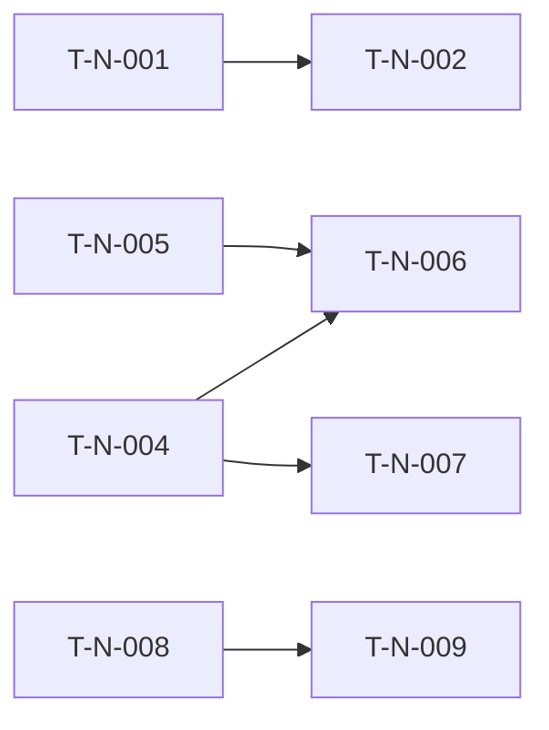

# Build Site: Newsletter

## Source Kit

cavekit-newsletter.md: R1 (Subscribe Endpoint), R2 (Subscribe UI Feedback), R3 (Unsubscribe), R4 (Subscriber Count)

## Project Context

- **Runtime:** Bun
- **Framework:** Elysia (v1.2.x)
- **Rendering:** Server-side HTML string templates (no template engine)
- **Email:** Resend API (already integrated in `src/newsletter/subscribers.ts` and `src/auth/magic-link.ts`)
- **Subscriber Storage:** Filesystem-backed JSON at `data/subscribers.json`
- **HMAC Signing:** Exists in `src/auth/magic-link.ts` (reusable pattern for unsubscribe tokens)

## Existing Code Assessment

| Component | Status | Notes |
|-----------|--------|-------|
| `POST /subscribe` endpoint | Exists | Validates email, stores subscriber, sends welcome email, redirects with query params |
| `addSubscriber()` | Exists | Deduplicates by email, stores with timestamp |
| `getSubscriberCount()` | Exists | Reads from `data/subscribers.json` |
| `sendWelcomeEmail()` | Exists | Sends via Resend, but has NO unsubscribe link in body |
| Newsletter form in templates | Exists | Has `required` attribute on email input |
| `GET /api/subscriber-count` | Exists | Reads from Buy Me a Coffee API, NOT local storage |
| Success/error message rendering | Missing | Server redirects with `?subscribed=1` / `?subscribe_error=1` but home route ignores query params and `renderHome()` renders no messages |
| Unsubscribe endpoint | Missing | No route, no token generation, no subscriber removal function |
| `removeSubscriber()` | Missing | No function to remove a subscriber from storage |
| Unsubscribe token signing | Missing | But HMAC pattern in `magic-link.ts` is directly reusable |
| Unsubscribe confirmation page | Missing | No template function for this |

---

## Implementation Sequence

### T-N-001: Subscribe Endpoint Audit and Hardening [MOSTLY DONE]
**Cavekit Requirement:** Newsletter/R1
**Acceptance Criteria Mapped:** R1-AC1, R1-AC2, R1-AC3, R1-AC4, R1-AC5, R1-AC6, R1-AC7
**blockedBy:** none
**Effort:** S
**Description:**
Audit the existing `POST /subscribe` endpoint in `src/server.ts` and `addSubscriber()` in `src/newsletter/subscribers.ts` against all R1 acceptance criteria. What already works:

- AC1: POST /subscribe accepts form data with "email" field -- DONE (line 245-258 of server.ts)
- AC2: Invalid emails redirect to `/?subscribe_error=1` -- DONE (line 248)
- AC3: Valid new emails stored in `data/subscribers.json` with email and timestamp -- DONE (subscribers.ts:38)
- AC4: Duplicate emails not added again -- DONE (subscribers.ts:36 checks `subs.some()`)
- AC5: Welcome email sent via Resend -- DONE (server.ts:252, async fire-and-forget with `.catch()`)
- AC6: If Resend API key missing or send fails, subscriber still stored -- DONE (addSubscriber runs before sendWelcomeEmail)
- AC7: After subscribe, user redirected to homepage with success indicator -- DONE (redirects to `/?subscribed=1`)

What to verify/fix:
1. Confirm that the email regex rejects truly malformed addresses (e.g., "not-an-email", "@no-local", "spaces in@email.com"). The current regex `/^[^\s@]+@[^\s@]+\.[^\s@]+$/` is reasonable for MVP.
2. Confirm duplicate emails redirect with `?subscribed=1` (success, not error) -- currently the code redirects to `/?subscribed=1` regardless of `isNew`, which matches AC7 ("After subscribe (success or duplicate)").

This task is essentially a verification pass. No code changes expected unless the audit reveals a gap.

**Files:** `src/server.ts`, `src/newsletter/subscribers.ts`
**Test Strategy:** Manual test: submit valid email (new), verify stored and welcome sent. Submit same email again, verify no duplicate in JSON and user sees success. Submit invalid email, verify redirect with error param.

---

### T-N-002: Subscribe UI Feedback Messages
**Cavekit Requirement:** Newsletter/R2
**Acceptance Criteria Mapped:** R2-AC1, R2-AC2, R2-AC4, R2-AC5
**blockedBy:** T-N-001
**Effort:** S
**Description:**
The server already redirects to `/?subscribed=1` and `/?subscribe_error=1`, but the homepage does NOT read these query params or render any messages. This task adds the missing UI feedback.

Changes needed:

1. **`src/server.ts`** -- Modify the `GET /` route handler to read `query.subscribed` and `query.subscribe_error` and pass them to `renderHome()`:
   ```
   .get("/", async ({ query }) => {
     const articles = await loadArticles();
     const subscribeStatus = query.subscribed === "1" ? "success" : query.subscribe_error === "1" ? "error" : null;
     return html(renderHome(articles, subscribeStatus));
   })
   ```

2. **`src/templates.ts`** -- Update `renderHome()` signature to accept an optional `subscribeStatus` parameter. Update the `newsletter()` function to accept this param and render a message:
   - If `subscribeStatus === "success"`: render a styled success banner near the newsletter form, e.g., "You're in! Check your inbox for a welcome message."
   - If `subscribeStatus === "error"`: render a styled error banner, e.g., "Please enter a valid email address."
   - Style using palette tokens (`P.gold` for success background, `P.accent` for error).

3. **Auto-dismiss**: Add a small inline `<script>` that removes the message after 8 seconds, OR add a dismiss (X) button. The simplest approach: use `history.replaceState` to strip query params after rendering (prevents message reappearing on refresh), and a CSS animation that fades the message out after 8s.

**Files:** `src/server.ts`, `src/templates.ts`
**Test Strategy:** Navigate to `/?subscribed=1`, verify success message visible near newsletter form, styled consistently. Navigate to `/?subscribe_error=1`, verify error message visible. Refresh the page after message shown -- message should not reappear (query params stripped). Wait 8s -- message should fade out.

---

### T-N-003: Subscribe Form Required Attribute Verification [DONE]
**Cavekit Requirement:** Newsletter/R2
**Acceptance Criteria Mapped:** R2-AC3
**blockedBy:** none
**Effort:** S
**Description:**
Verify the newsletter form's email input has the HTML `required` attribute. This is already present in `src/templates.ts` line 368:

```html
<input type="email" name="email" placeholder="your.address@homestead.com" required/>
```

The `type="email"` attribute also provides browser-native validation for email format. No code changes needed.

**Status:** DONE -- verification only.

**Files:** `src/templates.ts`
**Test Strategy:** Inspect the rendered newsletter form HTML. Confirm `required` attribute present on the email input. Try submitting empty form in browser -- browser should prevent submission.

---

### T-N-004: Unsubscribe Token Generation
**Cavekit Requirement:** Newsletter/R3
**Acceptance Criteria Mapped:** R3-AC2, R3-AC5, R3-AC6
**blockedBy:** none
**Effort:** S
**Description:**
Create unsubscribe token generation in `src/newsletter/subscribers.ts` (or a new `src/newsletter/unsubscribe.ts`). Reuse the HMAC signing pattern from `src/auth/magic-link.ts`.

Implementation:
1. Create `generateUnsubscribeToken(email: string): string` -- HMAC-sign the email (no expiry needed for unsubscribe tokens, unlike magic links).
   - Payload: `{ email: string }` (base64url encoded).
   - Signature: `HMAC-SHA256` using the same `MAGIC_LINK_SECRET` env var (or a dedicated `UNSUBSCRIBE_SECRET`, but reusing the existing one is simpler).
   - Token format: `{base64url-data}.{base64url-signature}` (same as magic-link.ts).

2. Create `verifyUnsubscribeToken(token: string): string | null` -- returns the email if valid, null if signature is invalid.

3. Create `generateUnsubscribeUrl(email: string): string` -- uses `getConfig().url` to build the full URL: `{baseUrl}/unsubscribe?token={token}`.

The base URL comes from `getConfig().url` (AC6: not hardcoded).

**Files:** `src/newsletter/subscribers.ts` (add functions) or new `src/newsletter/unsubscribe.ts`
**Test Strategy:** Unit test: generate token for email, verify it returns that email. Generate token for different email, verify cross-check fails. Tamper with token, verify null returned. Verify URL uses config base URL.

---

### T-N-005: Add removeSubscriber Function
**Cavekit Requirement:** Newsletter/R3
**Acceptance Criteria Mapped:** R3-AC1
**blockedBy:** none
**Effort:** S
**Description:**
Add `removeSubscriber(email: string): Promise<boolean>` to `src/newsletter/subscribers.ts`. Loads the subscriber list, filters out the matching email (case-insensitive), saves back. Returns true if a subscriber was actually removed, false if email was not found.

Implementation:
```typescript
export async function removeSubscriber(email: string): Promise<boolean> {
  const subs = await load();
  const lower = email.toLowerCase().trim();
  const filtered = subs.filter((s) => s.email !== lower);
  if (filtered.length === subs.length) return false; // not found
  await save(filtered);
  return true;
}
```

**Files:** `src/newsletter/subscribers.ts`
**Test Strategy:** Add subscriber, remove it, verify count decreased. Remove non-existent email, verify returns false. Remove subscriber, verify they are gone from the JSON file.

---

### T-N-006: Unsubscribe Endpoint and Confirmation Page
**Cavekit Requirement:** Newsletter/R3
**Acceptance Criteria Mapped:** R3-AC1, R3-AC3, R3-AC4
**blockedBy:** T-N-004, T-N-005
**Effort:** M
**Description:**
Add `GET /unsubscribe` route to `src/server.ts`. Implementation:

1. Read `token` from query params.
2. Verify token using `verifyUnsubscribeToken()`.
3. If invalid or missing: render a generic message page ("We couldn't process your request. The link may be invalid."). Do NOT reveal whether the email exists or not (AC4).
4. If valid: call `removeSubscriber(email)`. Regardless of whether the subscriber was found (they may have already unsubscribed), render a confirmation page: "You've been unsubscribed. You will no longer receive emails from us."
5. The confirmation page uses the standard site layout (nav + footer) for consistency.

Add a `renderUnsubscribe(success: boolean)` template function in `src/templates.ts`:
- `success=true`: "You've been unsubscribed." message with a link back to homepage.
- `success=false`: "We couldn't process your request." generic message.

**Files:** `src/server.ts`, `src/templates.ts`
**Test Strategy:** Visit `/unsubscribe?token={valid}` for existing subscriber -- verify removed from storage, confirmation page shown. Visit with same token again -- confirmation page still shown (idempotent). Visit with invalid/tampered token -- generic error message, no details leaked. Visit with no token -- generic error message.

---

### T-N-007: Add Unsubscribe Link to Welcome Email
**Cavekit Requirement:** Newsletter/R3
**Acceptance Criteria Mapped:** R3-AC5, R3-AC6
**blockedBy:** T-N-004
**Effort:** S
**Description:**
Modify `sendWelcomeEmail()` in `src/newsletter/subscribers.ts` to include an unsubscribe link in the email body. The link uses `generateUnsubscribeUrl(email)` which builds the URL from config (not hardcoded).

Changes to the HTML email template:
- Add an unsubscribe link in the footer area of the email, below the existing `<hr>` and site name line.
- Example: `<p style="..."><a href="{unsubscribeUrl}">Unsubscribe</a></p>`
- The link text should be subtle but clearly visible (standard email convention).

Also add the `List-Unsubscribe` header to the Resend API call body for email client compatibility:
```json
{
  "headers": {
    "List-Unsubscribe": "<{unsubscribeUrl}>"
  }
}
```

**Files:** `src/newsletter/subscribers.ts`
**Test Strategy:** Subscribe a test email, inspect the welcome email body for unsubscribe link. Verify the link URL points to `{config.url}/unsubscribe?token=...`. Click the link, verify it works (unsubscribes).

---

### T-N-008: Subscriber Count Endpoint -- Use Local Storage
**Cavekit Requirement:** Newsletter/R4
**Acceptance Criteria Mapped:** R4-AC1, R4-AC2
**blockedBy:** none
**Effort:** S
**Description:**
The existing `GET /api/subscriber-count` reads from Buy Me a Coffee API and adds a hardcoded base of 8000. The kit requires the count to combine a configured base number with the real subscriber count from local storage (`data/subscribers.json`).

Changes to `src/server.ts`:

Replace the current BMaC API fetch with a call to `getSubscriberCount()` from `src/newsletter/subscribers.ts`:

```typescript
.get("/api/subscriber-count", async () => {
  const real = await getSubscriberCount();
  const cfg = getConfig();
  // Parse the configured base count text (e.g., "84,512" -> 84512)
  const base = parseInt(cfg.subscriberCountText.replace(/,/g, ""), 10) || 0;
  const total = base + real;
  const display = total.toLocaleString("en-US");
  return Response.json({ count: total, display });
})
```

Note: The current implementation uses `subscriberCountText` (string "84,512") as the static display text. The kit says the display count should be `base + real`. We parse the config text as the base number and add the real local subscriber count.

If the team wants to keep BMaC integration alongside local counts, that would be an enhancement beyond the kit scope. The kit specifies "real subscriber count from storage" only.

**Files:** `src/server.ts`
**Test Strategy:** Add 3 test subscribers to storage. Call `GET /api/subscriber-count`. Verify response JSON contains `count` = base + 3. Verify `display` is formatted with commas.

---

### T-N-009: Subscriber Count Client-Side Rendering
**Cavekit Requirement:** Newsletter/R4
**Acceptance Criteria Mapped:** R4-AC3, R4-AC4
**blockedBy:** T-N-008
**Effort:** S
**Description:**
Verify the existing client-side fetch updates the subscriber count on page load. The current code in `src/templates.ts` (inside the `nav()` function, line 286) already does this:

```javascript
fetch('/api/subscriber-count').then(r => r.json()).then(d => {
  if(!d.display) return;
  ['sub-count','sub-count-nl'].forEach(id => {
    var el = document.getElementById(id);
    if(el) el.textContent = d.display;
  });
}).catch(() => {});
```

This updates both `#sub-count` (header eyebrow) and `#sub-count-nl` (newsletter section). Both elements exist in the templates.

What to verify:
- AC3: The count is rendered in both the header eyebrow (`nav()`) and the newsletter section (`newsletter()`). Both have `id="sub-count"` and `id="sub-count-nl"` respectively -- DONE.
- AC4: The count updates without page reload (client-side fetch on page load) -- DONE.

This task is a verification pass. No code changes expected unless T-N-008 changes the response shape (which it does: changing from `{ real, display }` to `{ count, display }`). The client-side code only uses `d.display`, so the rename of `real` to `count` does not break it.

**Status:** DONE (pending T-N-008 shape compatibility, which is confirmed compatible).

**Files:** `src/templates.ts`
**Test Strategy:** Load homepage, open browser devtools Network tab. Verify `/api/subscriber-count` is called. Verify the response `display` value appears in the header eyebrow and newsletter section.

---

## Tier Summary

### Tier 0 -- No Dependencies (Start Here)
- **T-N-001:** Subscribe Endpoint Audit [MOSTLY DONE] -- Newsletter/R1
- **T-N-003:** Form Required Attribute Verification [DONE] -- Newsletter/R2-AC3
- **T-N-004:** Unsubscribe Token Generation -- Newsletter/R3
- **T-N-005:** Add removeSubscriber Function -- Newsletter/R3
- **T-N-008:** Subscriber Count Endpoint (local storage) -- Newsletter/R4

### Tier 1 -- Depends on Tier 0
- **T-N-002:** Subscribe UI Feedback Messages (blockedBy: T-N-001) -- Newsletter/R2
- **T-N-006:** Unsubscribe Endpoint + Confirmation Page (blockedBy: T-N-004, T-N-005) -- Newsletter/R3
- **T-N-007:** Add Unsubscribe Link to Welcome Email (blockedBy: T-N-004) -- Newsletter/R3
- **T-N-009:** Subscriber Count Client-Side Rendering [DONE] (blockedBy: T-N-008) -- Newsletter/R4

---

## Dependency Graph



### Parallelization Opportunities

- **Tier 0:** T-N-001, T-N-003, T-N-004, T-N-005, and T-N-008 can all start simultaneously (zero dependencies between them).
- **Tier 1:** After T-N-004 completes, T-N-006 and T-N-007 can run in parallel with each other (T-N-006 also needs T-N-005). T-N-002 only needs T-N-001.

---

## Coverage Matrix

Every acceptance criterion from cavekit-newsletter.md mapped to its implementing task(s). Any criterion without a task is a GAP.

### Newsletter/R1: Subscribe Endpoint

| AC ID | Criterion Summary | Task(s) | Status |
|-------|-------------------|---------|--------|
| R1-AC1 | POST /subscribe accepts form data with "email" field | T-N-001 | Exists |
| R1-AC2 | Invalid emails redirect with error indicator | T-N-001 | Exists |
| R1-AC3 | Valid new emails stored in data/subscribers.json with email + timestamp | T-N-001 | Exists |
| R1-AC4 | Duplicate emails not added again | T-N-001 | Exists |
| R1-AC5 | Welcome email sent via Resend after successful subscribe | T-N-001 | Exists |
| R1-AC6 | If Resend fails, subscriber still stored (non-blocking) | T-N-001 | Exists |
| R1-AC7 | After subscribe (success or duplicate), redirect with success indicator | T-N-001 | Exists |

### Newsletter/R2: Subscribe UI Feedback

| AC ID | Criterion Summary | Task(s) | Status |
|-------|-------------------|---------|--------|
| R2-AC1 | ?subscribed=1 shows visible success message near form | T-N-002 | Missing |
| R2-AC2 | ?subscribe_error=1 shows visible error message | T-N-002 | Missing |
| R2-AC3 | Form input has HTML "required" attribute | T-N-003 | Exists |
| R2-AC4 | Messages styled consistently with design system | T-N-002 | Missing |
| R2-AC5 | Messages auto-dismiss or are dismissible | T-N-002 | Missing |

### Newsletter/R3: Unsubscribe

| AC ID | Criterion Summary | Task(s) | Status |
|-------|-------------------|---------|--------|
| R3-AC1 | GET /unsubscribe?token={signed_token} removes subscriber from storage | T-N-005, T-N-006 | Missing |
| R3-AC2 | Unsubscribe token is HMAC-signed | T-N-004 | Missing |
| R3-AC3 | Successful unsubscribe shows confirmation page | T-N-006 | Missing |
| R3-AC4 | Invalid token / email not found shows generic message (no details leaked) | T-N-006 | Missing |
| R3-AC5 | Welcome email includes unsubscribe link with valid signed token | T-N-007 | Missing |
| R3-AC6 | Unsubscribe link uses site's configured base URL (not hardcoded) | T-N-004, T-N-007 | Missing |

### Newsletter/R4: Subscriber Count

| AC ID | Criterion Summary | Task(s) | Status |
|-------|-------------------|---------|--------|
| R4-AC1 | GET /api/subscriber-count returns JSON with display count | T-N-008 | Exists (but reads from BMaC, not local) |
| R4-AC2 | Display count = configured base + real count from storage | T-N-008 | Missing (currently uses BMaC API) |
| R4-AC3 | Homepage renders count in header eyebrow and newsletter section | T-N-009 | Exists |
| R4-AC4 | Count updates without page reload (client-side fetch) | T-N-009 | Exists |

### GAP Analysis

No gaps found. All 21 acceptance criteria across 4 requirements are covered by at least one task.

---

## Summary

| Category | Tasks | Effort |
|----------|-------|--------|
| Verification only (already done) | T-N-001, T-N-003, T-N-009 | 3S |
| New implementation needed | T-N-002, T-N-004, T-N-005, T-N-006, T-N-007, T-N-008 | 5S + 1M |
| **Total** | **9 tasks** | **8S + 1M** |

Estimated total implementation time for new work: ~2-3 hours.
