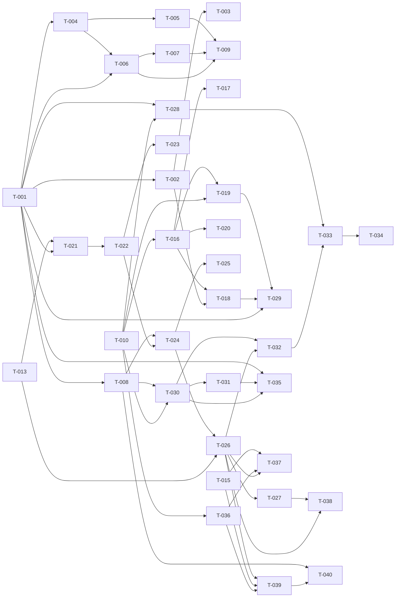

# Build Site

## Project Context

- **Runtime:** Bun
- **Framework:** Elysia (v1.2.x)
- **Rendering:** Server-side HTML string templates (no template engine)
- **Styling:** CSS embedded in template functions
- **Content:** Markdown files with YAML frontmatter in `content/articles/`
- **Source Kits:** 5 domains, 24 requirements, 124 acceptance criteria

## Build Order

Site -> Content + Auth (parallel) -> Vault -> Community

---

## Tier 0 -- Foundation (No Dependencies)

### T-001: Site Configuration Schema and Loader
**Cavekit Requirement:** Site/R1
**Acceptance Criteria Mapped:** Site/R1-AC1, Site/R1-AC2
**blockedBy:** none
**Effort:** M
**Description:**
Create `src/config.ts` exporting a typed site configuration object. Define the full schema: site name, tagline, description, navigation items (label + href), footer columns (grouped links), legal disclaimer, subscriber count text, social links (platform + URL), paywall window (default 30 days), min pledge threshold (default $3), session expiration (default 30 days), Patreon OAuth client ID/secret, OAuth callback URL, admin user IDs. Load from a `site.config.ts` file at project root (or `config/site.ts`). Export a `getConfig()` function that returns the frozen config object.
**Files:** `src/config.ts`, `site.config.ts`
**Test Strategy:** Unit test that config loads with all required fields. Test that defaults apply when optional fields omitted.

---

### T-002: Category Registry in Configuration
**Cavekit Requirement:** Site/R2
**Acceptance Criteria Mapped:** Site/R2-AC1, Site/R2-AC2, Site/R2-AC3, Site/R2-AC5
**blockedBy:** T-001
**Effort:** S
**Description:**
Add a `categories` array to site config with shape `{ slug: string, name: string, description: string }[]`. Export a `getCategory(slug: string)` helper that returns the category or null. Export `getAllCategories()`. Ensure templates can iterate categories from config rather than hardcoding nav links.
**Files:** `src/config.ts`, `site.config.ts`
**Test Strategy:** Unit test adding/removing categories from config and verifying `getCategory` / `getAllCategories` behavior. Test that unknown slugs return null.

---

### T-003: Graceful Unknown Category Fallback
**Cavekit Requirement:** Site/R2
**Acceptance Criteria Mapped:** Site/R2-AC4
**blockedBy:** T-002
**Effort:** S
**Description:**
When an article references a category slug not present in config, the article still renders without error. The template uses a generic fallback (no category label, no category-specific styling). Ensure `getCategory(slug)` returning null triggers this path.
**Files:** `src/templates.ts`, `src/config.ts`
**Test Strategy:** Create a test article with a non-existent category slug, verify it renders without error and shows no category label.

---

### T-004: Palette and Typography Tokens
**Cavekit Requirement:** Site/R3
**Acceptance Criteria Mapped:** Site/R3-AC1, Site/R3-AC2, Site/R3-AC3, Site/R3-AC4
**blockedBy:** T-001
**Effort:** M
**Description:**
Move the hardcoded `P` object and `FONT` constant from `src/templates.ts` into site config as `palette` (named tokens: bg, paper, ink, muted, gold, accent, deep) and `typography` (named tokens: heading, body, mono). Create a `generateCSS()` function that reads palette/typography from config and produces the CSS variables or inline style strings. Refactor `templates.ts` to import palette/font values from config rather than defining them inline.
**Files:** `site.config.ts`, `src/config.ts`, `src/templates.ts`
**Test Strategy:** Change a palette token in config, verify the generated CSS reflects the new value. Grep templates.ts for hardcoded hex values -- should find none outside the config consumption layer.

---

### T-005: Eliminate Hardcoded Colors and Fonts from Templates
**Cavekit Requirement:** Site/R3
**Acceptance Criteria Mapped:** Site/R3-AC5
**blockedBy:** T-004
**Effort:** M
**Description:**
Audit and refactor all template files to ensure zero hex color literals, RGB values, or hardcoded font family names exist outside the config-to-stylesheet generation layer. Replace any remaining instances with references to config tokens. This is an enforcement pass after T-004's structural work.
**Files:** `src/templates.ts`, `src/illustrations.ts`
**Test Strategy:** Grep all `.ts` files (excluding config files and test fixtures) for hex patterns (#[0-9a-fA-F]{3,8}) and font family strings. Zero matches expected.

---

### T-006: Config-Driven Navigation Rendering
**Cavekit Requirement:** Site/R1
**Acceptance Criteria Mapped:** Site/R1-AC3, Site/R1-AC4, Site/R1-AC5
**blockedBy:** T-001, T-004
**Effort:** M
**Description:**
Refactor the `nav()` function in `templates.ts` to read navigation items from config instead of hardcoding links. The site name in the nav logo must come from config. Adding/removing a nav item in config must cause it to appear/disappear with no code changes. The footer brand name must also come from config.
**Files:** `src/templates.ts`, `site.config.ts`
**Test Strategy:** Add a nav item to config, render the nav, verify it appears. Remove one, verify it disappears. Change site name, verify it propagates to nav and footer.

---

### T-007: Config-Driven Footer, Legal, and Social Links
**Cavekit Requirement:** Site/R1
**Acceptance Criteria Mapped:** Site/R1-AC6, Site/R1-AC7
**blockedBy:** T-006
**Effort:** S
**Description:**
Refactor `footer()` in `templates.ts` to render footer columns, legal disclaimer, and social links from config. Changing the legal text in config updates it everywhere. Adding a social link entry causes it to appear in the social links area.
**Files:** `src/templates.ts`, `site.config.ts`
**Test Strategy:** Change legal disclaimer text in config, verify it renders with new text. Add a social link, verify it appears.

---

### T-008: Config-Driven Operational Parameters Integration
**Cavekit Requirement:** Site/R1
**Acceptance Criteria Mapped:** Site/R1-AC8, Site/R1-AC9
**blockedBy:** T-001
**Effort:** S
**Description:**
Ensure the operational parameters (paywall window, pledge threshold) are exported from config and consumable by downstream modules (Vault, Auth). This task validates the contract -- the actual consumption happens in Vault/Auth tasks. Write integration tests that verify changing these values in config changes the exported values.
**Files:** `src/config.ts`
**Test Strategy:** Unit test that changing `paywallWindowDays` and `minPledgeThreshold` in config produces different values from `getConfig()`.

---

### T-009: White-Label Isolation Audit
**Cavekit Requirement:** Site/R4
**Acceptance Criteria Mapped:** Site/R4-AC1, Site/R4-AC2, Site/R4-AC3
**blockedBy:** T-006, T-007, T-005
**Effort:** S
**Description:**
Final audit pass: grep all template, stylesheet, and application source files for the literal string "The Ancestral Forge" (or any other brand-specific string). All instances must be traced back to config reads. Document that duplicating the project with different config values produces a rebranded site. All user-visible identity text must be sourced from config at render time.
**Files:** All `src/*.ts` files
**Test Strategy:** `grep -r "The Ancestral Forge" src/` returns zero results (only config files and test fixtures allowed). `grep -r "Ancestral" src/` same check.

---

### T-010: Article Metadata Schema and Defaults
**Cavekit Requirement:** Content/R2
**Acceptance Criteria Mapped:** Content/R2-AC1, Content/R2-AC2, Content/R2-AC3, Content/R2-AC4, Content/R2-AC5, Content/R2-AC6, Content/R2-AC7
**blockedBy:** none
**Effort:** M
**Description:**
Refactor the `Article` interface and `parseFrontmatter` in `src/content.ts`. Define the full schema: title (required), slug (default: directory name), category, tags (array, default []), author, authorRole, date (required), readTime, excerpt, illustration, featured (default false), free (default false). Ensure only title and date are required. Unknown fields are silently ignored. Add `tags` as an array field (currently only `tag` string exists).
**Files:** `src/content.ts`
**Test Strategy:** Unit test: article with only title+date loads. Article with unknown fields loads without error. Defaults applied correctly for slug, tags, featured, free.

---

### T-011: Markdown Renderer -- Full Construct Support
**Cavekit Requirement:** Content/R7
**Acceptance Criteria Mapped:** Content/R7-AC1, Content/R7-AC3, Content/R7-AC4, Content/R7-AC5
**blockedBy:** none
**Effort:** M
**Description:**
Enhance `markdownToHtml()` in `src/content.ts` to support all required constructs: h1-h6, bold, italic, links (`[text](url)`), ordered lists, unordered lists, fenced code blocks (``` delimited), inline code, blockquotes (> prefix), and images (``). Currently missing: links, images, code blocks, blockquotes, h4-h6. Links must preserve href. Images must preserve alt text. Code blocks must preserve whitespace.
**Files:** `src/content.ts`
**Test Strategy:** Unit test each construct: render markdown with each type, verify correct HTML output. Test links have correct href, images have alt text, code blocks preserve whitespace.

---

### T-012: Markdown XSS Sanitization
**Cavekit Requirement:** Content/R7
**Acceptance Criteria Mapped:** Content/R7-AC2
**blockedBy:** T-011
**Effort:** S
**Description:**
Add HTML sanitization to the markdown renderer. Strip `<script>` tags and event handler attributes (onclick, onerror, etc.) from any raw HTML embedded in markdown. Do not strip all HTML -- only dangerous elements/attributes.
**Files:** `src/content.ts`
**Test Strategy:** Unit test: markdown containing `<script>alert('xss')</script>` renders without the script tag. Markdown with `` strips the onerror attribute.

---

### T-013: Session Management Infrastructure
**Cavekit Requirement:** Auth/R2
**Acceptance Criteria Mapped:** Auth/R2-AC1, Auth/R2-AC2, Auth/R2-AC3, Auth/R2-AC5, Auth/R2-AC6
**blockedBy:** none
**Effort:** M
**Description:**
Create `src/auth/sessions.ts`. Implement an in-memory session store (Map<sessionId, SessionData>) with filesystem backup for persistence. Session tokens are crypto-random (use `crypto.randomUUID()` or `crypto.getRandomValues()`). Sessions stored as HTTP-only cookies. Expiration configurable (default 30 days from Site config). Expired sessions return null on lookup. Provide `createSession(data)`, `getSession(id)`, `destroySession(id)` exports.
**Files:** `src/auth/sessions.ts`
**Test Strategy:** Unit test: create session returns unique token. Lookup existing session returns data. Expired session returns null. Destroy session makes it inaccessible. Token is cryptographically random (not sequential).

---

### T-014: Session Logout
**Cavekit Requirement:** Auth/R2
**Acceptance Criteria Mapped:** Auth/R2-AC4
**blockedBy:** T-013
**Effort:** S
**Description:**
Add a `/logout` route to the Elysia app. On GET /logout, destroy the session, clear the session cookie, and redirect to home page. Subsequent requests from the same browser must be unauthenticated.
**Files:** `src/server.ts`, `src/auth/sessions.ts`
**Test Strategy:** Integration test: create session, hit /logout, verify cookie cleared and session destroyed. Next request to protected resource shows unauthenticated state.

---

### T-015: Content Safety Module (Comments)
**Cavekit Requirement:** Community/R5
**Acceptance Criteria Mapped:** Community/R5-AC1, Community/R5-AC2, Community/R5-AC3, Community/R5-AC4, Community/R5-AC5
**blockedBy:** none
**Effort:** S
**Description:**
Create `src/community/safety.ts`. Implement `escapeHtml(input: string): string` that escapes `<`, `>`, `&`, `"`, `'`. Implement `linkify(text: string): string` that detects URLs and wraps them in `<a href="..." target="_blank" rel="noopener">` tags. Implement `sanitizeDisplayName(name: string): string` that escapes HTML in display names. Script tags and event handlers in comment text must not execute.
**Files:** `src/community/safety.ts`
**Test Strategy:** Unit test: HTML tags escaped to entities. Script tags rendered as text. URLs become clickable links with target="_blank" and rel="noopener". Display names with HTML are escaped.

---

## Tier 1 -- Content Loading and Auth (Depends on Tier 0)

### T-016: Article Loading from Filesystem
**Cavekit Requirement:** Content/R1
**Acceptance Criteria Mapped:** Content/R1-AC1, Content/R1-AC4, Content/R1-AC5
**blockedBy:** T-010
**Effort:** S
**Description:**
Refactor `loadArticles()` to validate directory structure (each article = directory with index.md). Skip directories missing the markdown file without error. Read content from the path defined in config (or convention: `content/articles/`). Ensure the existing loading logic aligns with the content directory convention.
**Files:** `src/content.ts`
**Test Strategy:** Test: valid article dir loads. Dir without index.md is skipped silently. Content path is configurable or follows convention.

---

### T-017: Hot Reload and Error Resilience
**Cavekit Requirement:** Content/R1
**Acceptance Criteria Mapped:** Content/R1-AC2, Content/R1-AC3
**blockedBy:** T-016
**Effort:** M
**Description:**
Implement hot reload: new article directories become available without server restart. Options: (a) reload articles on each request (simple, current behavior), or (b) use `fs.watch` with a debounced reload. Given this is Bun with `--watch` for dev, the simplest approach is to not cache articles permanently -- reload from disk on each request (already the case). Add error resilience: articles with malformed frontmatter log a warning and are skipped, not crash the server. Use try/catch around individual article parsing.
**Files:** `src/content.ts`
**Test Strategy:** Add new article dir at runtime, verify it appears on next request without restart. Create article with invalid YAML frontmatter, verify server continues running and logs a warning.

---

### T-018: Category Pages
**Cavekit Requirement:** Content/R3
**Acceptance Criteria Mapped:** Content/R3-AC1, Content/R3-AC2, Content/R3-AC5, Content/R3-AC7
**blockedBy:** T-002, T-016
**Effort:** M
**Description:**
Add route `GET /category/:slug` to Elysia. Filter loaded articles by category matching the slug. Sort by date descending. Render a listing page with article cards. If no articles match (or slug does not exist in config), render an empty state message (not an error page, not a 404).
**Files:** `src/server.ts`, `src/templates.ts`
**Test Strategy:** Request /category/valid-slug returns articles in that category sorted by date. Request /category/nonexistent returns empty state HTML, not 404 or 500.

---

### T-019: Tag Pages
**Cavekit Requirement:** Content/R3
**Acceptance Criteria Mapped:** Content/R3-AC3, Content/R3-AC4, Content/R3-AC6, Content/R3-AC7
**blockedBy:** T-010, T-016
**Effort:** M
**Description:**
Add route `GET /tag/:slug` to Elysia. Filter loaded articles where `tags` array includes the slug. Sort by date descending. Render a listing page. If no articles match, render an empty state message (not an error). Non-existent tags show the empty state, not a server error.
**Files:** `src/server.ts`, `src/templates.ts`
**Test Strategy:** Request /tag/valid-tag returns matching articles sorted by date. Request /tag/nonexistent returns empty state.

---

### T-020: Search Endpoint
**Cavekit Requirement:** Content/R4
**Acceptance Criteria Mapped:** Content/R4-AC1, Content/R4-AC2, Content/R4-AC3, Content/R4-AC4, Content/R4-AC5, Content/R4-AC6
**blockedBy:** T-016
**Effort:** M
**Description:**
Add route `GET /search` accepting query param `q`. Search article titles, excerpts, and body content. Case-insensitive matching. Rank results: title matches weighted highest, then excerpt, then body. Return a rendered results page. Empty/missing `q` shows a prompt message. No results shows an informational empty state.
**Files:** `src/server.ts`, `src/templates.ts`, `src/content.ts`
**Test Strategy:** Search for term in title returns that article first. Same term case-varied returns same results. Empty q shows prompt. No match shows empty state.

---

### T-021: Patreon OAuth Redirect (Login Initiation)
**Cavekit Requirement:** Auth/R1
**Acceptance Criteria Mapped:** Auth/R1-AC1
**blockedBy:** T-001, T-013
**Effort:** S
**Description:**
Add route `GET /auth/login` that redirects the user's browser to Patreon's OAuth authorization endpoint. Include client_id from config, redirect_uri (callback URL from config), response_type=code, and appropriate scopes (identity, identity[email], campaigns.members). Store the referrer/origin page in a cookie or state param for post-login redirect.
**Files:** `src/auth/patreon.ts`, `src/server.ts`
**Test Strategy:** GET /auth/login returns 302 with Location header pointing to patreon.com/oauth2/authorize with correct params.

---

### T-022: Patreon OAuth Callback
**Cavekit Requirement:** Auth/R1
**Acceptance Criteria Mapped:** Auth/R1-AC2, Auth/R1-AC3
**blockedBy:** T-021
**Effort:** M
**Description:**
Add route `GET /auth/callback`. Extract the `code` param. Exchange it with Patreon's token endpoint for an access token. Use the access token to fetch user identity and pledge information from Patreon API. Create a session (via T-013) storing user ID, display name, and pledge data. Set the session cookie. Redirect to the page the user came from (stored in state) or home page as fallback.
**Files:** `src/auth/patreon.ts`, `src/server.ts`
**Test Strategy:** Mock Patreon API responses. Verify successful callback creates session, sets cookie, and redirects. Verify user data (displayName, pledge) stored in session.

---

### T-023: Patreon OAuth Error Handling
**Cavekit Requirement:** Auth/R1
**Acceptance Criteria Mapped:** Auth/R1-AC4, Auth/R1-AC5
**blockedBy:** T-022
**Effort:** S
**Description:**
Handle error cases in the OAuth flow: (1) user denies access (Patreon redirects with `error` param) -- show error message, redirect to home. (2) Token exchange fails (network error, invalid response) -- show error message, do not leave user in broken state. All error paths log the error and redirect to a page with a visible error message.
**Files:** `src/auth/patreon.ts`, `src/server.ts`, `src/templates.ts`
**Test Strategy:** Simulate denied access (error param in callback). Simulate token exchange failure. Verify both show user-visible error and no server crash.

---

### T-024: Pledge Verification Logic
**Cavekit Requirement:** Auth/R3
**Acceptance Criteria Mapped:** Auth/R3-AC1, Auth/R3-AC2, Auth/R3-AC3
**blockedBy:** T-022, T-008
**Effort:** M
**Description:**
In `src/auth/patreon.ts`, implement pledge verification: after fetching user data from Patreon, check if active pledge >= min threshold from config. Mark session with `isPatron: true` if meets threshold, `false` otherwise. Handle edge cases: no pledge, declined pledge, pledge below threshold all result in `isPatron: false`.
**Files:** `src/auth/patreon.ts`, `src/auth/sessions.ts`
**Test Strategy:** Unit test: user with $5 pledge -> isPatron true. User with $2 pledge -> false. User with no pledge -> false. User with declined pledge -> false. Threshold from config respected.

---

### T-025: Pledge Status Refresh
**Cavekit Requirement:** Auth/R3
**Acceptance Criteria Mapped:** Auth/R3-AC4, Auth/R3-AC5, Auth/R3-AC6
**blockedBy:** T-024
**Effort:** M
**Description:**
Implement periodic pledge refresh. Store `lastPledgeCheck` timestamp in session. On request, if time since last check exceeds refresh interval (configurable, e.g. 1 hour), re-query Patreon API for current pledge status. Between refreshes, use cached status. If refresh fails (API unavailable), retain cached status and log a warning.
**Files:** `src/auth/patreon.ts`, `src/auth/sessions.ts`
**Test Strategy:** Unit test: session within refresh window returns cached status without API call. Session past refresh window triggers API call. Failed refresh retains old status and logs warning.

---

### T-026: User Context Middleware
**Cavekit Requirement:** Auth/R4
**Acceptance Criteria Mapped:** Auth/R4-AC1, Auth/R4-AC2, Auth/R4-AC3, Auth/R4-AC4
**blockedBy:** T-013, T-024
**Effort:** M
**Description:**
Create Elysia middleware (derive/beforeHandle) that reads the session cookie, looks up the session, and attaches `{ isLoggedIn, isPatron, displayName }` to the request context. Unauthenticated: `{ isLoggedIn: false, isPatron: false, displayName: null }`. Authenticated non-patron: `{ isLoggedIn: true, isPatron: false, displayName: "..." }`. Authenticated patron: `{ isLoggedIn: true, isPatron: true, displayName: "..." }`. Available on every route.
**Files:** `src/auth/middleware.ts`, `src/server.ts`
**Test Strategy:** Integration test: request without cookie gets unauthenticated context. Request with valid non-patron session gets correct context. Request with patron session gets patron context.

---

### T-027: Login Prompt for Patron-Only Features
**Cavekit Requirement:** Auth/R4
**Acceptance Criteria Mapped:** Auth/R4-AC5
**blockedBy:** T-026
**Effort:** S
**Description:**
In templates that render patron-only functionality (comment form, vault content), show a login prompt to unauthenticated users. The prompt links to /auth/login. This is a template-level concern: check `userContext.isLoggedIn` and render either the feature or the prompt.
**Files:** `src/templates.ts`
**Test Strategy:** Render an article page with unauthenticated context -- verify login prompt appears where patron features would be.

---

### T-028: SEO Meta Tags for Article Pages
**Cavekit Requirement:** Content/R6
**Acceptance Criteria Mapped:** Content/R6-AC1, Content/R6-AC4
**blockedBy:** T-010, T-001
**Effort:** S
**Description:**
Enhance the `head()` function in `templates.ts` to accept SEO params. For article pages: title tag = "Article Title -- Site Name", meta description = article excerpt, og:title, og:description, og:image (from article illustration, falling back to site default image from config).
**Files:** `src/templates.ts`
**Test Strategy:** Render article page, verify title tag format, meta description present, og tags present. Article without illustration uses site default og:image.

---

### T-029: SEO Meta Tags for Home and Listing Pages
**Cavekit Requirement:** Content/R6
**Acceptance Criteria Mapped:** Content/R6-AC2, Content/R6-AC3
**blockedBy:** T-001, T-018, T-019
**Effort:** S
**Description:**
Home page: title = site name + tagline from config, meta description = site description from config, og:title, og:description. Category pages: title = "Category Name -- Site Name". Tag pages: title = "Tag Name -- Site Name". All from config values.
**Files:** `src/templates.ts`
**Test Strategy:** Render home page, verify site-level meta tags. Render category page, verify title includes category name.

---

## Tier 2 -- Vault (Depends on Tier 1)

### T-030: Time-Based Paywall Decision Logic
**Cavekit Requirement:** Vault/R1
**Acceptance Criteria Mapped:** Vault/R1-AC1, Vault/R1-AC2, Vault/R1-AC3, Vault/R1-AC4, Vault/R1-AC5
**blockedBy:** T-010, T-008
**Effort:** M
**Description:**
Create `src/vault/paywall.ts`. Implement `isArticleGated(article: Article, config: SiteConfig): boolean`. Compare article.date to current date. If within `paywallWindowDays` from config, article is gated. If outside window, article is public. The decision uses the article's `date` field from frontmatter vs `Date.now()`.
**Files:** `src/vault/paywall.ts`
**Test Strategy:** Unit test: article dated today -> gated. Article dated 31 days ago (with 30-day window) -> not gated. Change window to 60 days, article 31 days old -> gated.

---

### T-031: Vault Override (free flag)
**Cavekit Requirement:** Vault/R4
**Acceptance Criteria Mapped:** Vault/R4-AC1, Vault/R4-AC2, Vault/R4-AC3
**blockedBy:** T-030
**Effort:** S
**Description:**
Extend `isArticleGated()` to check `article.free`. If `free: true`, return false (not gated) regardless of date. If `free: false` or not set, apply normal time-based rule. The free flag is per-article -- does not affect other articles.
**Files:** `src/vault/paywall.ts`
**Test Strategy:** Unit test: article with free:true dated today -> not gated. Article without free flag dated today -> gated. Setting free on one article does not affect another.

---

### T-032: Patron Bypass
**Cavekit Requirement:** Vault/R2
**Acceptance Criteria Mapped:** Vault/R2-AC1, Vault/R2-AC2, Vault/R2-AC3
**blockedBy:** T-026, T-030
**Effort:** S
**Description:**
Create `canUserAccessArticle(article, config, userContext): boolean`. If `userContext.isPatron === true`, return true (full access). Otherwise, delegate to `isArticleGated()`. Vault does not independently verify pledge status -- it trusts Auth user context.
**Files:** `src/vault/paywall.ts`
**Test Strategy:** Unit test: patron user can access gated article. Non-patron cannot access gated article. Non-patron can access old/free articles. Patron can access everything.

---

### T-033: Paywall UI -- Article Page Locked State
**Cavekit Requirement:** Vault/R3
**Acceptance Criteria Mapped:** Vault/R3-AC1, Vault/R3-AC2, Vault/R3-AC3
**blockedBy:** T-032, T-028
**Effort:** M
**Description:**
Modify article page rendering: if article is gated and user lacks access, render only the excerpt, illustration, and metadata (title, author, date, category, tags, read time). Below the excerpt, render a paywall message with CTA to Patreon. The full article body must NOT be present in the page source (not hidden with CSS -- simply not rendered server-side).
**Files:** `src/templates.ts`, `src/server.ts`
**Test Strategy:** Render gated article as non-patron. Verify excerpt visible, body text NOT in page source. Verify paywall CTA present. Render same article as patron, verify full body present.

---

### T-034: Paywall UI -- Lock Indicator on Listings
**Cavekit Requirement:** Vault/R3
**Acceptance Criteria Mapped:** Vault/R3-AC4, Vault/R3-AC5
**blockedBy:** T-033
**Effort:** S
**Description:**
On listing pages (home, category, tag, search results), gated articles display a lock icon/indicator alongside other articles. Gated articles remain clickable and navigable -- the lock is informational only. Do not hide gated articles from listings.
**Files:** `src/templates.ts`
**Test Strategy:** Render home page with mix of gated and public articles. Verify gated articles have lock indicator. Verify they are still clickable links.

---

### T-035: RSS Feed Generation
**Cavekit Requirement:** Content/R5
**Acceptance Criteria Mapped:** Content/R5-AC1, Content/R5-AC2, Content/R5-AC3, Content/R5-AC4, Content/R5-AC5, Content/R5-AC6
**blockedBy:** T-030, T-031, T-001
**Effort:** M
**Description:**
Add route `GET /rss` returning RSS 2.0 XML. Channel element includes site name, description, link from config. Each article item includes title, link, description (excerpt or full content), pubDate. For gated articles (per Vault rules), description contains only the excerpt. For public articles (past window or free:true), description contains full content or excerpt. Well-formed XML with proper RSS 2.0 structure.
**Files:** `src/server.ts`, `src/content.ts` (or new `src/rss.ts`)
**Test Strategy:** GET /rss returns valid XML. Validate against RSS 2.0 spec (well-formed, required elements present). Gated article has only excerpt in description. Public article has full content. Channel has site metadata from config.

---

## Tier 3 -- Community (Depends on Tier 2)

### T-036: Comment Storage Layer
**Cavekit Requirement:** Community/R3
**Acceptance Criteria Mapped:** Community/R3-AC1, Community/R3-AC2, Community/R3-AC3, Community/R3-AC4
**blockedBy:** T-010
**Effort:** M
**Description:**
Create `src/community/storage.ts`. Store comments as JSON files on the filesystem, one file per article slug (e.g., `data/comments/{slug}.json`). Each comment: `{ id, authorId, authorName, body, timestamp }`. Provide `getComments(slug)`, `addComment(slug, comment)`, `deleteComment(slug, commentId)`. Comments survive server restart. Handle write failures gracefully (return error, don't crash).
**Files:** `src/community/storage.ts`
**Test Strategy:** Unit test: add comment, read it back. Restart (re-import module), comments persist. Comments for article A do not appear for article B. Simulate write failure, verify error returned without crash.

---

### T-037: Comment Submission Endpoint
**Cavekit Requirement:** Community/R1
**Acceptance Criteria Mapped:** Community/R1-AC1, Community/R1-AC4, Community/R1-AC5, Community/R1-AC6
**blockedBy:** T-026, T-036, T-015
**Effort:** M
**Description:**
Add route `POST /articles/:slug/comments`. Require authenticated patron (check userContext.isPatron). Accept body field. Validate non-empty body (reject with validation message if empty). Sanitize body via safety module (T-015). Store via storage layer. After success, redirect back to article page (comment visible immediately). Non-patrons and unauthenticated users who somehow POST get rejected.
**Files:** `src/server.ts`, `src/community/storage.ts`
**Test Strategy:** POST as patron with body -> comment created, redirect to article. POST with empty body -> validation error. POST as non-patron -> rejected. POST as unauthenticated -> rejected.

---

### T-038: Comment Form UI (Patron/Non-Patron/Anonymous States)
**Cavekit Requirement:** Community/R1
**Acceptance Criteria Mapped:** Community/R1-AC1, Community/R1-AC2, Community/R1-AC3
**blockedBy:** T-026, T-027
**Effort:** S
**Description:**
On article pages, below content: if isLoggedIn && isPatron -> show comment form. If isLoggedIn && !isPatron -> show message "Commenting is a patron benefit" with link to Patreon. If !isLoggedIn -> show "Log in via Patreon to comment" prompt with login link.
**Files:** `src/templates.ts`
**Test Strategy:** Render article page as patron -> form visible. As logged-in non-patron -> patron benefit message. As anonymous -> login prompt.

---

### T-039: Comment Display
**Cavekit Requirement:** Community/R2
**Acceptance Criteria Mapped:** Community/R2-AC1, Community/R2-AC2, Community/R2-AC3, Community/R2-AC4
**blockedBy:** T-036, T-015, T-026
**Effort:** M
**Description:**
On article pages, display all comments below article content (above the comment form). Visible to ALL visitors regardless of auth. Each comment shows: author display name (escaped), timestamp, body (escaped, linkified). Ordered chronologically oldest first. Empty state: patrons see "Be the first to comment", non-patrons/anonymous see "No comments yet" or comment count of zero.
**Files:** `src/templates.ts`, `src/server.ts`
**Test Strategy:** Render article with comments -> all visible, ordered oldest first. Render article with no comments as patron -> "Be the first" message. As non-patron -> shows zero comments.

---

### T-040: Comment Moderation (Admin Delete)
**Cavekit Requirement:** Community/R4
**Acceptance Criteria Mapped:** Community/R4-AC1, Community/R4-AC2, Community/R4-AC3, Community/R4-AC4, Community/R4-AC5
**blockedBy:** T-039, T-008
**Effort:** M
**Description:**
Site config has admin identifier(s) field. In comment display, if the current user's ID matches an admin ID from config, show a delete button on each comment. Add route `POST /articles/:slug/comments/:id/delete`. Verify requester is admin (check user ID against config). Delete from storage. Non-admin users do not see delete button and cannot hit the endpoint successfully (rejected with 403).
**Files:** `src/server.ts`, `src/templates.ts`, `src/community/storage.ts`, `src/config.ts`
**Test Strategy:** Admin user sees delete button on comments. Non-admin does not. Admin POSTs delete -> comment removed. Non-admin POSTs delete -> 403.

---

## Dependency Graph



---

## Coverage Matrix

Every acceptance criterion mapped to its implementing task(s).

### Site Domain

| AC ID | Criterion Summary | Task(s) |
|-------|-------------------|---------|
| Site/R1-AC1 | Config contains all identity fields | T-001 |
| Site/R1-AC2 | Config contains operational params | T-001 |
| Site/R1-AC3 | Site name change propagates to nav, footer, titles, meta | T-006 |
| Site/R1-AC4 | Adding nav item renders in navbar | T-006 |
| Site/R1-AC5 | Removing nav item removes from navbar | T-006 |
| Site/R1-AC6 | Legal disclaimer text from config | T-007 |
| Site/R1-AC7 | Social link addition renders | T-007 |
| Site/R1-AC8 | Paywall window config changes gating | T-008 |
| Site/R1-AC9 | Pledge threshold config changes access | T-008 |
| Site/R2-AC1 | Categories defined in config with name+slug | T-002 |
| Site/R2-AC2 | Adding category makes it available | T-002 |
| Site/R2-AC3 | Removing category removes from nav/listings | T-002 |
| Site/R2-AC4 | Unknown category slug renders without error | T-003 |
| Site/R2-AC5 | Category has slug, name, description | T-002 |
| Site/R3-AC1 | Palette tokens in config | T-004 |
| Site/R3-AC2 | Font tokens in config | T-004 |
| Site/R3-AC3 | Changing palette token changes color everywhere | T-004 |
| Site/R3-AC4 | Changing font token changes font everywhere | T-004 |
| Site/R3-AC5 | No hardcoded colors/fonts in templates | T-005 |
| Site/R4-AC1 | No brand strings in source code | T-009 |
| Site/R4-AC2 | Replace config = fully rebranded site | T-009 |
| Site/R4-AC3 | All identity text from config at render time | T-009 |

### Content Domain

| AC ID | Criterion Summary | Task(s) |
|-------|-------------------|---------|
| Content/R1-AC1 | Article = directory with markdown + frontmatter | T-016 |
| Content/R1-AC2 | New article available without restart | T-017 |
| Content/R1-AC3 | Malformed frontmatter skipped with warning | T-017 |
| Content/R1-AC4 | Missing markdown file skipped | T-016 |
| Content/R1-AC5 | Content directory path defined | T-016 |
| Content/R2-AC1 | Frontmatter supports full field set | T-010 |
| Content/R2-AC2 | Only title+date required | T-010 |
| Content/R2-AC3 | Slug defaults to directory name | T-010 |
| Content/R2-AC4 | Tags defaults to empty array | T-010 |
| Content/R2-AC5 | Featured defaults to false | T-010 |
| Content/R2-AC6 | Free defaults to false | T-010 |
| Content/R2-AC7 | Unknown fields ignored | T-010 |
| Content/R3-AC1 | /category/:slug shows category articles | T-018 |
| Content/R3-AC2 | Category articles sorted by date desc | T-018 |
| Content/R3-AC3 | /tag/:slug shows tagged articles | T-019 |
| Content/R3-AC4 | Tag articles sorted by date desc | T-019 |
| Content/R3-AC5 | Empty category shows message not error | T-018 |
| Content/R3-AC6 | Empty tag shows message not error | T-019 |
| Content/R3-AC7 | Non-existent slug returns empty state | T-018, T-019 |
| Content/R4-AC1 | /search?q= endpoint exists | T-020 |
| Content/R4-AC2 | Matches titles, excerpts, body | T-020 |
| Content/R4-AC3 | Relevance ranked (title > body) | T-020 |
| Content/R4-AC4 | Case-insensitive | T-020 |
| Content/R4-AC5 | No results = empty state | T-020 |
| Content/R4-AC6 | Empty query = prompt | T-020 |
| Content/R5-AC1 | /rss returns RSS 2.0 XML | T-035 |
| Content/R5-AC2 | RSS validates against spec | T-035 |
| Content/R5-AC3 | Items include title, link, description, pubDate | T-035 |
| Content/R5-AC4 | Gated articles: excerpt only | T-035 |
| Content/R5-AC5 | Public articles: full content | T-035 |
| Content/R5-AC6 | Channel includes site metadata from config | T-035 |
| Content/R6-AC1 | Article pages: title, meta desc, og tags | T-028 |
| Content/R6-AC2 | Home page: site-level meta tags | T-029 |
| Content/R6-AC3 | Category/tag pages: title with name | T-029 |
| Content/R6-AC4 | og:image fallback to site default | T-028 |
| Content/R7-AC1 | All markdown constructs render correctly | T-011 |
| Content/R7-AC2 | Raw HTML sanitized (scripts stripped) | T-012 |
| Content/R7-AC3 | Links functional with correct href | T-011 |
| Content/R7-AC4 | Images display with alt text | T-011 |
| Content/R7-AC5 | Code blocks preserve whitespace | T-011 |

### Auth Domain

| AC ID | Criterion Summary | Task(s) |
|-------|-------------------|---------|
| Auth/R1-AC1 | Login redirects to Patreon OAuth | T-021 |
| Auth/R1-AC2 | Callback receives grant from Patreon | T-022 |
| Auth/R1-AC3 | Successful callback creates session, redirects | T-022 |
| Auth/R1-AC4 | User denies access -> error message shown | T-023 |
| Auth/R1-AC5 | Token exchange failure -> error message | T-023 |
| Auth/R2-AC1 | Auth state persists across page loads | T-013 |
| Auth/R2-AC2 | Sessions via cookie | T-013 |
| Auth/R2-AC3 | Configurable expiration (default 30 days) | T-013 |
| Auth/R2-AC4 | Logout destroys session | T-014 |
| Auth/R2-AC5 | Expired sessions treated as unauth | T-013 |
| Auth/R2-AC6 | Crypto-random session tokens | T-013 |
| Auth/R3-AC1 | $3+ pledge = patron | T-024 |
| Auth/R3-AC2 | Below $3 or no pledge = not patron | T-024 |
| Auth/R3-AC3 | Threshold configurable | T-024 |
| Auth/R3-AC4 | Periodic refresh of pledge status | T-025 |
| Auth/R3-AC5 | Cached status between refreshes | T-025 |
| Auth/R3-AC6 | Failed refresh retains cached status | T-025 |
| Auth/R4-AC1 | Every route has user context | T-026 |
| Auth/R4-AC2 | Unauth: isLoggedIn=false, isPatron=false, null name | T-026 |
| Auth/R4-AC3 | Auth non-patron: isLoggedIn=true, isPatron=false, name | T-026 |
| Auth/R4-AC4 | Auth patron: isLoggedIn=true, isPatron=true, name | T-026 |
| Auth/R4-AC5 | Login prompt for patron-only features | T-027 |

### Vault Domain

| AC ID | Criterion Summary | Task(s) |
|-------|-------------------|---------|
| Vault/R1-AC1 | Recent article gated for non-patrons | T-030 |
| Vault/R1-AC2 | Old article (>30d) public for all | T-030 |
| Vault/R1-AC3 | Paywall window configurable | T-030 |
| Vault/R1-AC4 | Changing window changes gating | T-030 |
| Vault/R1-AC5 | Decision based on article date vs now | T-030 |
| Vault/R2-AC1 | Patron sees full content of gated articles | T-032 |
| Vault/R2-AC2 | Non-patron cannot see gated content | T-032 |
| Vault/R2-AC3 | Vault trusts Auth context, no independent check | T-032 |
| Vault/R3-AC1 | Gated page shows excerpt + metadata | T-033 |
| Vault/R3-AC2 | Paywall CTA below excerpt | T-033 |
| Vault/R3-AC3 | Full body not in page source | T-033 |
| Vault/R3-AC4 | Lock indicator on listings | T-034 |
| Vault/R3-AC5 | Gated articles remain clickable | T-034 |
| Vault/R4-AC1 | free:true = public regardless of date | T-031 |
| Vault/R4-AC2 | No free flag = normal paywall | T-031 |
| Vault/R4-AC3 | Per-article flag only | T-031 |

### Community Domain

| AC ID | Criterion Summary | Task(s) |
|-------|-------------------|---------|
| Community/R1-AC1 | Form shown to logged-in patrons | T-038 |
| Community/R1-AC2 | Non-patron message: patron benefit | T-038 |
| Community/R1-AC3 | Anonymous prompt: log in | T-038 |
| Community/R1-AC4 | Submit creates comment on article | T-037 |
| Community/R1-AC5 | Empty body rejected | T-037 |
| Community/R1-AC6 | New comment immediately visible | T-037 |
| Community/R2-AC1 | Comments visible to all visitors | T-039 |
| Community/R2-AC2 | Shows author, timestamp, body | T-039 |
| Community/R2-AC3 | Ordered oldest first | T-039 |
| Community/R2-AC4 | Empty state: patron vs non-patron messaging | T-039 |
| Community/R3-AC1 | Comments written to filesystem | T-036 |
| Community/R3-AC2 | Survive server restart | T-036 |
| Community/R3-AC3 | Scoped per article slug | T-036 |
| Community/R3-AC4 | Write failure returns error, no crash | T-036 |
| Community/R4-AC1 | Admin IDs in config | T-040 |
| Community/R4-AC2 | Admin sees delete action | T-040 |
| Community/R4-AC3 | Delete removes from display and storage | T-040 |
| Community/R4-AC4 | Non-admin cannot see delete | T-040 |
| Community/R4-AC5 | Non-admin delete rejected | T-040 |
| Community/R5-AC1 | HTML tags escaped | T-015 |
| Community/R5-AC2 | Script tags do not execute | T-015 |
| Community/R5-AC3 | URLs rendered as clickable links | T-015 |
| Community/R5-AC4 | Links: target="_blank" rel="noopener" | T-015 |
| Community/R5-AC5 | Display names escaped | T-015 |

---

## Summary

| Tier | Tasks | Effort Distribution |
|------|-------|---------------------|
| Tier 0 (Foundation) | T-001 through T-015 | 4S, 7M, 4S = 5S + 8M + 2L |
| Tier 1 (Content + Auth) | T-016 through T-029 | 5S + 9M |
| Tier 2 (Vault) | T-030 through T-035 | 2S + 4M |
| Tier 3 (Community) | T-036 through T-040 | 0S + 5M |
| **Total** | **40 tasks** | **12S + 26M + 2L** |

### Parallelization Opportunities

- **Tier 0:** T-001, T-010, T-011, T-013, T-015 can all start in parallel (no dependencies on each other)
- **Tier 1:** After T-001 completes, T-006/T-008/T-021 can run parallel. After T-010, T-016/T-019 can run parallel. T-018 waits for both T-002 and T-016.
- **Tier 2:** T-030 and T-032 can run once their deps resolve. T-035 (RSS) is independent of T-033/T-034 (UI).
- **Tier 3:** T-036 can start as soon as T-010 is done (same tier as Vault tasks). T-037/T-038/T-039 depend on T-026 from Auth.
